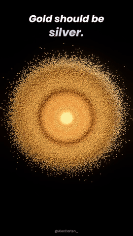
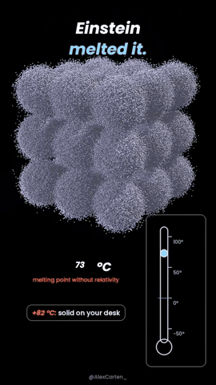
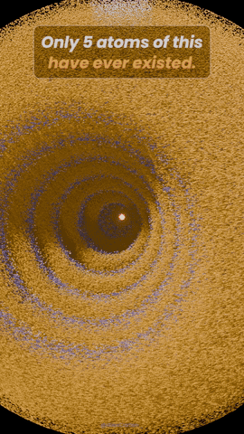
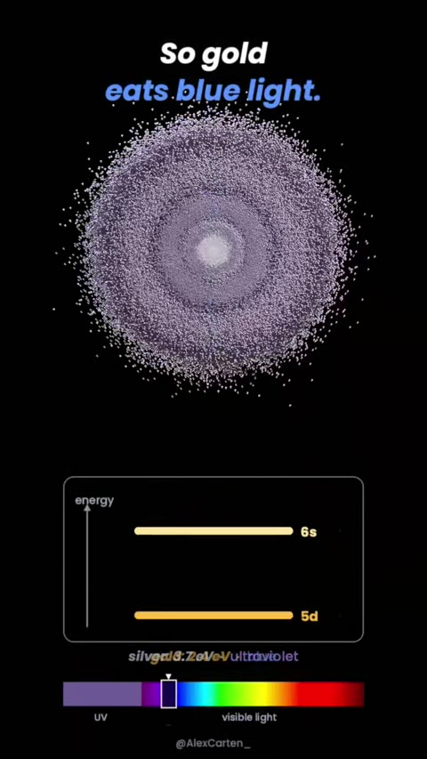
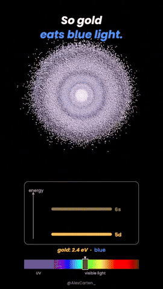
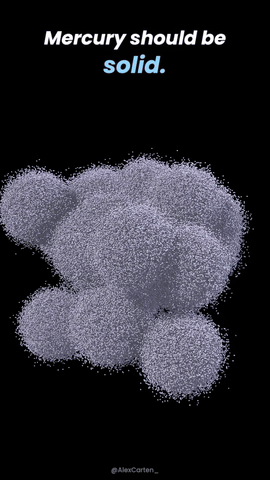
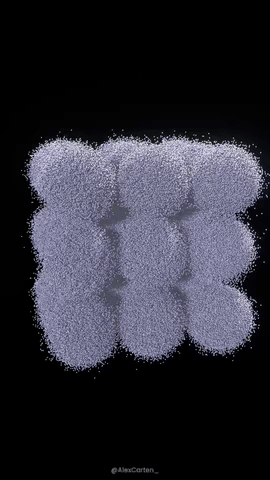
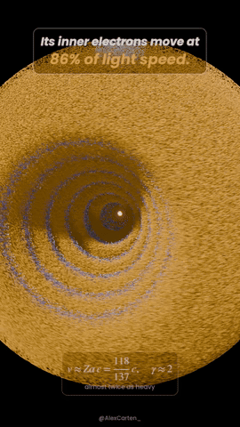
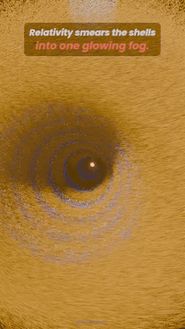

<div align="center">

# Einstein's Metals

**Why gold is gold, mercury is liquid and element 118 melts — relativity inside the atom, built from millions of particles.**

 &nbsp;  &nbsp; 

<sub>rendered in Blender with the scripts in this repo</sub>

*Every gold ring is a relativity experiment.*

[Watch on X](https://x.com/AlexCarten_) · Blender 4.2+ / 5.x · Python 3.10+

</div>

---

## The idea

Heavy atoms pull so hard on their inner electrons that those electrons move at a large fraction of the speed of light:

$$v \approx Z\alpha\,c = \frac{Z}{137}\,c$$

For gold (Z = 79) and mercury (Z = 80) that is about **58 % of c**. At that speed relativity matters:

$$\gamma = \frac{1}{\sqrt{1 - v^2/c^2}} \approx 1.22$$

The outer **6s** orbital contracts by roughly 17 %, and two famous metals change completely.

## 1 · Gold — why it isn't silver

 &nbsp;  &nbsp; 

| | silver | gold |
|---|---|---|
| 5d → 6s gap | ~3.7 eV | ~2.4 eV |
| absorbs | ultraviolet | **blue** |
| looks | silver | **yellow** |

The contracted 6s level drops closer to 5d. The gap falls from the ultraviolet into the blue,
so gold absorbs blue light and reflects what is left: yellow.

`gold/gold_blender.py` — 30 s: gold → silver ("without Einstein") → dive to the core and a live 0 → 58 % counter →
γ = 1.22 and the 6s contraction → energy levels and the absorption notch sliding from UV into blue → gold again.

## 2 · Mercury — why it's liquid

 &nbsp;  &nbsp; 

Mercury's 6s shell is the same contracted shell — and it is **already full** (6s²).
The atoms have almost nothing to share, so they barely bond. Relativistic simulations (2017) put its melting point at
**~+82 °C without relativity** and **−39 °C with it** (the real value).

`mercury/mercury_blender.py` — 30 s: liquid → a 27-atom crystal → dive into 1 atom (0 → 58 % of c, 6s shrinks) →
the bonds between atoms fade → a thermometer falls from +82 °C to −39 °C and the crystal melts.

## 3 · Oganesson — the atom that melts

 &nbsp;  &nbsp; 

Element 118: 118 electrons in 7 shells, and about **86 % of c** for the inner electrons (γ ≈ 2).
Relativistic calculations (Jerabek et al., PRL 2018) show its shell structure smearing out almost into an electron gas.
Smits et al. (2020) predict it is a **solid at room temperature (melts ~52 °C)**, not the noble gas the table promises.
Only about 5 atoms have ever been made (Dubna, 2002–2005), each lasting under 1 ms.

`oganesson/oganesson_blender.py` — 30 s: a cut-away atom with 7 nested shells and a hot nucleus → electrons speed up →
the shells smear into one fog → "the table says gas, the math says solid" → 5 atoms, under 1 ms each.
Grains flow around the axis: orange one way, blue the other, white slow.

## Run it

1. `File → New → General`
2. `Scripting → Open → gold/gold_blender.py` (or `mercury/…`, `oganesson/…`) `→ Run Script`
3. `Ctrl + F12` → the video lands in `~/OrbitalRenders/<element>/`

Everything is baked (keyframes + Geometry Nodes): no Python runs during playback or render.
Each grain is a small lit metal sphere with real shadows.

| setting | gold | mercury | what it does |
|---|---|---|---|
| `N6S` | 2,600,000 | 100,000 per atom × 27 | grains in the outer 6s cloud |
| `N5D` | 1,200,000 | 30,000 per atom | grains in the 5d cloud |
| `NCORE` | 300,000 | 8,000 per atom | grains in the core |
| `POINT_PX` | 4.0 | 5.0 | grain size on screen |
| `BRIGHT` | 1.4 | 1.5 | strength of the lights |

### Music

Original ambient scores, timed to each video, generated from code (no samples):

```bash
pip install numpy scipy soundfile
python gold/gold_music.py        # -> gold_music.wav
python mercury/mercury_music.py  # -> mercury_music.wav
python oganesson/oganesson_music.py  # -> oganesson_music.wav
```

Drop the `.wav` at 0 s on top of the render.

## Honest notes

- Electron clouds use **hydrogen-like** radial shapes (6s, 5d, core) sampled from |ψ|² — an illustration of the real effect, not a full relativistic calculation.
- The numbers (58 % of c, γ ≈ 1.22, ~17 % contraction, 3.7 → 2.4 eV, +82 → −39 °C) come from the relativistic quantum chemistry literature (Pyykkö's reviews; the 2017 mercury melting-point simulations).
- Oganesson: shell radii and smearing are illustrative; the 86 % / γ ≈ 2 / ~52 °C / ~5 atoms figures are from the papers above.
- There is a cat hidden in the gold and mercury videos 🐈, and an "Og 118" tile in the oganesson one.

## Credits

Made by **Alex Carten** — [@AlexCarten_](https://x.com/AlexCarten_).
Code: MIT. Font: Poppins (SIL OFL 1.1), embedded in the scripts.
